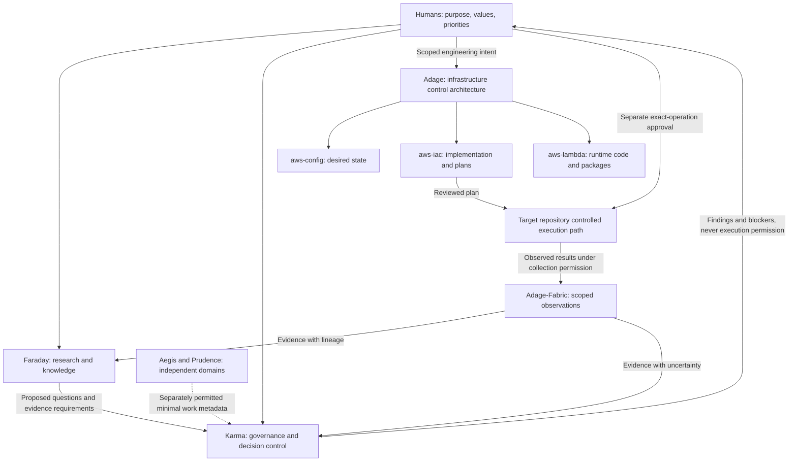

# Ecosystem Architecture

Status: **proposed initial charter; not adopted**. Human review and explicit adoption are required.

## Responsibility model

The following diagram expresses proposed logical handoffs, not deployed integrations, network connectivity, or executable routing. Every arrow is subject to a versioned contract, data-sharing permission, and target-repository controls.

The feedback path is a design direction. It does not imply that Fabric currently receives all execution outcomes, or that Karma can dispatch work. Faraday's knowledge decisions and Karma's continuation findings must remain distinguishable from human authorization.

## Ownership and interfaces

Faraday specifies the question, assumptions, competing explanations, falsification criteria, experiment bounds, and expected evidence. Implementation remains with the target repository. Routing requires the existing human gates; this charter routes no work package and changes no active program.

Karma evaluates evidence and work metadata against explicit scope, provenance, dependencies, and review conditions. Its inspected steward component supports a bounded offline synthetic contract; it is not a live coordination service. A general policy engine and authenticated cross-repository active-work registry remain unproven.

Adage defines infrastructure separation. `aws-config` owns non-secret desired declarations and environment bindings. SSM bridges published configuration and runtime discovery; it is not Terraform state, live inventory, or approval. `aws-iac` owns resource lifecycle, IAM, wiring, planning and separately authorized execution paths. `aws-lambda` owns application source, tests, packaging and runtime contracts. Versioned artifact handoff is distinct from permission to publish or deploy.

Adage-Fabric owns event-processing structure, not the truth of producer claims. Preserve original occurrence identity separately from delivery and entity identity, event time separately from receipt time, transform/schema revisions, and quarantine reasons where the relevant contract requires them. A checksum does not authenticate the producer. A semantic view or temporal association does not establish cause.

Aegis owns care coordination and per-subject consent; Prudence owns financial/business scenarios and their assumptions. Their records and future stores remain separate. Shared work metadata must exclude domain records and disclose only separately authorized, minimum-necessary information. Metadata and opaque IDs can still be sensitive. No central private record store is proposed.

The template supplies reusable engineering practices. It does not own domain facts, provide release authorization, or make generated projects production-ready.

## Existing contract boundaries

- Faraday's ecosystem/epistemic/authority registries document research versus execution responsibilities.
- Karma's `karma.faraday-work.v0` intake document remains a proposed lifecycle; it is not a live dispatcher.
- `karma.steward-work.v1` is an offline synthetic metadata contract with pinned vendored implementations and negative conformance tests, not authenticated real-world consent or approval.
- Lambda declaration v1 separates package identity from desired declarations and infrastructure wiring. Missing artifact/principal prerequisites remain blocked.

[Repositories](REPOSITORIES.md) pins the sources. These contracts have different scopes and maturity. This charter neither replaces them nor implies compatibility between them.

## Future capabilities requiring separate decisions

A shared dependency vocabulary could connect evidence applicability, assumptions, consent, approvals and artifacts. Automatic invalidation propagation, authenticated approval/revocation services, portable source adapters, real registry reconciliation, production evidence handoff, and outcome-driven research selection require their own specifications, threat models, tests and approvals. No implementation or integration is authorized here.
